# India Agricultural Evidence Assistant

A locally runnable, evidence-first RAG teaching prototype for agricultural research
documents. It is an evidence discovery demo, **not an official advisory service** and
not a substitute for current government guidance, pesticide labels, institutional review,
or local agronomists. The bundled documents are visibly synthetic teaching fixtures and
must never be used to make farming decisions.

## Architecture

```mermaid
flowchart LR
  PDF[PDF / Markdown / text] --> EX[Extract pages and metadata]
  EX --> CH[Heading and paragraph chunks]
  CH --> EMB[Multilingual local embeddings]
  EMB --> VS[(Persistent Chroma by default)]
  Q[Question + optional metadata filters] --> D[Dense retrieval via LlamaIndex]
  Q --> L[Independent BM25 retrieval]
  VS --> D
  VS --> L
  D --> F[Reciprocal-rank fusion]
  L --> F
  F --> R[Optional cross-encoder reranker]
  R --> G[Deterministic evidence and safety gate]
  G -->|Fail| A[Insufficient evidence / follow-up]
  G -->|Pass| M[Grounded local or OpenAI-compatible LLM]
  M --> CV[Validate source IDs and pages]
  CV --> OUT[Cited answer and inspectable source cards]
  Q --> AP[Optional bounded LLM research planner]
  AP -->|Original question + up to two searches| D
  E[Curated evaluation questions] --> EV[Retrieval, abstention, citation checks]
  EV --> RG[Optional Ragas diagnostics]
```



## Quick start

Requires Python 3.11–3.13. Model download is an explicit preparation step; the app is
configured to load cached Hugging Face models offline.

```sh
cd india-agricultural-evidence-assistant
python3.12 -m venv .venv
source .venv/bin/activate
python -m pip install --upgrade pip
pip install -e '.[dev]'
cp .env.example .env
python -m app.prepare_models
python -m app.ingest --input data/demo --input data/raw --rebuild
streamlit run streamlit_app.py --server.address 127.0.0.1 --server.port 8502
```

Python 3.12 is recommended for the setup commands above. Python 3.11–3.13 are
supported by the project, but on macOS some Python versions may require native build
tools to install Chroma's HNSW dependency.

### Restart after restarting VS Code or your system

The Streamlit process stops when the system shuts down. In the VS Code terminal, start it again from the project directory:

```sh
cd india-agricultural-evidence-assistant
source .venv/bin/activate
streamlit run streamlit_app.py --server.address 127.0.0.1 --server.port 8502
```

Then open [http://127.0.0.1:8502/](http://127.0.0.1:8502/). Leave the terminal running while you use the app; press `Ctrl+C` there to stop it. If you use the existing `.venv-py312` environment instead, run `./.venv-py312/bin/python -m streamlit run streamlit_app.py --server.address 127.0.0.1 --server.port 8502` from the project directory.

No paid API key is needed to start or query the app. The default `LLM_PROVIDER=none`
returns a cited extractive passage and does not call a generation model. For local answer
synthesis, install and start Ollama, then set `LLM_PROVIDER=ollama` and `LLM_MODEL` in
`.env`. For an OpenAI-compatible endpoint, set `LLM_PROVIDER=openai-compatible`,
`LLM_BASE_URL` (the server root, without `/v1`), `LLM_MODEL`, and optionally
`LLM_API_KEY`. Configured endpoints receive the question and retrieved passages. Never
put credentials in source code or paste them into the UI.

For a classroom Agentic RAG demonstration, start a local Ollama model and select it in
**Advanced answer settings**; the provider and model can be overridden for the current
browser session without editing `.env`. For example, with Ollama installed:

```sh
ollama pull llama3.1:8b
ollama serve
```

In another terminal, run the app, choose **Local Ollama model**, enter `llama3.1:8b`,
load **06 · Agentic research brief**, and submit. Model availability and hardware
requirements vary. An OpenAI-compatible endpoint can be selected instead; its configured
provider will receive both the research question and retrieved evidence.

The **Save settings** button stores the selected provider, model, and endpoint locally at
`data/index/ui-settings.json`, which is ignored by Git. These choices persist across
browser refreshes and app restarts on this machine. API keys are deliberately excluded;
store a persistent OpenAI-compatible API key in the ignored `.env` file instead.

## Field research workbench

The Streamlit interface is organized around a research workflow rather than a raw
question dropdown:

1. Select a field-research scenario or write a question, then choose automatic routing,
   text evidence, Agentic RAG, structured statistics, district comparison, or a
   current-advisory check.
2. Set optional crop, state, district, season, and source-status scope. Facets are derived
   from indexed metadata rather than hardcoded lists.
3. Review the answer claim-by-claim with citations mapped to source title, organization,
   and page; inspect full source passages and provenance when needed.
4. Open the retrieval trace to inspect dense and BM25 candidates, reciprocal-rank fusion,
   reranker state, and evidence-gate decision.
5. Browse the corpus registry to distinguish official-source summaries from synthetic
   test fixtures.

The starter scenarios demonstrate an ICAR regional training report, participation
metrics, FAO technical context, rice soil-and-water evidence, and deliberate abstention
on conflicting synthetic notes, plus an optional Agentic RAG multi-step research brief.
They are evidence-workflow demonstrations, not farm recommendations. The sidebar can
override the answer provider, model, endpoint, and API key for the current browser
session under **Advanced answer settings**; these overrides are not written to `.env`.
With the default extractive provider, the app surfaces cited evidence rather than claiming
to generate a synthesized LLM answer. Attendance/count questions route to validated
structured indicators when a specific event can be identified. The current-advisory
workflow requires an official advisory with an active validity interval and still applies
crop, location, and season checks; it abstains when the corpus cannot support that check.
Agentic research is an explicit, opt-in workflow requiring a configured LLM provider. The
planner may propose at most two short follow-up searches; the original question is always
searched, so at most three read-only hybrid retrieval actions run against the local index.
The model cannot execute arbitrary code, browse the web, or modify data. Retrieved passages
remain untrusted source data, and final synthesis uses the existing evidence gate and
citation validation. The trace exposes the plan queries, source IDs, tool calls, and model
call count, not hidden chain-of-thought. A rejected evidence gate skips the synthesis call.
The evaluation panel surfaces the latest persisted report and can explicitly run the
curated answerability, citation, and retrieval suite. The suite can take time and is never
launched automatically during app startup.

The **Structured evidence explorer** uses a separate deterministic path: it does not
vectorize numeric records or ask the LLM to calculate them. `data/structured/` contains
source-linked ICAR outreach counts, one DES Area/Production/Yield report row for wheat in
Ludhiana, and a district-wise extract with 23 Punjab wheat districts for Rabi 2022–2023.
The 23 district records were transcribed from the official DES interactive report view
using State=Punjab, District=All Districts, Crop=Wheat, Season=Rabi, Year=2022–2023.
Each DES SHA-256 identifies its normalized visible report row, not an official downloaded
file. Estimate status was not stated in the report view, so these historical values must
be verified against an official export before publication or decisions. District
comparisons are descriptive; they are not causal or agronomic recommendations.
The ICAR indicators are transcribed from local curator-written summaries and carry hashes
of those summary files; verify them against each linked original report before external
reuse. Derived participation shares are calculated from the source-reported counts.

`data/sources/source_registry.json` tracks the official candidate sources in the supplied
research shortlist, their intended modality, ingestion status, and access notes. Candidate
entries are discovery metadata, not imported evidence. Text PDFs and advisories belong in
the citation-preserving text pipeline; APY, weather, soil, and groundwater values require
structured rows with geography, season, units, reporting period, estimate/validity status,
source query, retrieval date, and an auditable content hash. Soil and rainfall maps require
a geospatial pipeline with CRS, resolution, dates, and methodology; they are not flattened
into prose chunks here. Availability and reuse terms must be checked before future acquisition. Do not present
an expired bulletin or historical estimate as current advice.

`python -m app.prepare_models` explicitly downloads and warms the configured embedding
model and optional cross-encoder. Run it before a live session. The default multilingual
embedding is `sentence-transformers/paraphrase-multilingual-MiniLM-L12-v2`; verify that
the required models are cached before disconnecting from the internet. No web scraping
or hidden launch-time corpus downloads are used.

## Add and ingest documents

Put locally curated PDF, Markdown, or UTF-8 text files in `data/raw/`. For each source,
add a neighboring metadata JSON file, for example `guide.pdf.meta.json`:

```json
{
  "title": "Title exactly as shown in the source",
  "organization": "Issuing organization, if shown",
  "source_url": "https://example.invalid/source",
  "issued_date": "2025-02-01",
  "state": "State, if specified",
  "district": "District, if specified",
  "crop": "Crop, if specified",
  "season": "Season, if specified",
  "language": "English",
  "document_type": "advisory",
  "status": "official"
}
```

Only record source details present in the source or supplied by the curator. Unknown
metadata stays blank; do not infer official status. Add multiple inputs as needed:

```sh
python -m app.ingest --input data/raw --rebuild
python -m app.ingest --input data/demo --input data/raw --rebuild
```

The starter corpus includes concise, curator-written summaries of three ICAR reports,
five FAO technical pages, and an IRRI rice water-management page in `data/raw/`. Each has
a metadata sidecar linking to its original page; these summaries are not full source
reproductions or farm recommendations. The FAO and IRRI pages provide international
technical context and must not be interpreted as India-specific or locally validated
advice. The IRRI page compares water input across soil textures and groundwater
conditions; it does not rank soils by yield or identify a universally best soil for rice.
Search-query examples and their expected source IDs are in `data/evaluation/authentic-source-search-queries.json` and
`data/evaluation/retrieval_questions.json`. The app's starter-index button indexes these
references and the clearly labeled synthetic fixtures.

Ingestion is stable and idempotent for unchanged documents; `--rebuild` clears the
selected index before re-indexing and writes `data/index/ingestion-manifest.json`.
Unsupported/failed documents and pages with little extractable text are reported in the
manifest. OCR is never implicit. To explicitly OCR empty PDF pages, install the optional
OCR extra and a local Tesseract executable, then run:

```sh
pip install -e '.[ocr]'
python -m app.ingest --input data/raw --rebuild --ocr
```

PDF text extraction uses PyMuPDF and preserves page numbers. Likely scanned pages are
flagged. PDF table-like layouts are flagged for manual review; Markdown tables retain
their row text. Chunk size and overlap are set in `app/chunking.py`.

## Framework and storage options

- **Default:** `RAG_FRAMEWORK=llamaindex`, `VECTOR_BACKEND=chroma`; Chroma is persistent
  and runs locally without a service.
- **LangChain retrieval comparison:** `pip install -e '.[langchain]'`, then set
  `RAG_FRAMEWORK=langchain`. Both adapters query the same collection and share lexical
  retrieval, RRF, reranking, evidence gate, and tests. Details are in
  [docs/framework-map.md](docs/framework-map.md).
- **Optional pgvector:** install `pip install -e '.[postgres]'`, replace both
  `change-me` values for `POSTGRES_PASSWORD` and `POSTGRES_DSN` in `.env` with the same
  strong local password, start `docker compose up -d`, set `VECTOR_BACKEND=pgvector`,
  then ingest again. Compose is only required for this optional backend. The pgvector
  adapter uses local SentenceTransformers embeddings and the same storage contract.

## Retrieval, answer safety, and limitations

The app retrieves dense and BM25 candidates independently and fuses them using
reciprocal-rank fusion with twice the weight on lexical ranks to preserve exact
agricultural terms and measurements. Cross-encoder reranking is optional; when unset or unavailable,
the app reports that state and continues with fused ranking. Cross-encoder outputs are
sigmoid-normalized to [0, 1] for the evidence threshold. The evidence gate applies
configurable score and question-term coverage thresholds. It identifies actionable
advisory requests by intent rather than matching isolated keyword substrings, checks for
missing crop/location/season context on those requests, and considers opposing guidance
only when the question asks for advice and the retrieved evidence matches crop/geography.
Current advice cannot use an advisory unless its validity dates include today;
undated/expired advisory records cause an abstention. Pesticide questions additionally
require a current official source. Factual questions about agricultural topics do not by
themselves trigger advisory-context checks.
Threshold defaults are demonstration starting points, not scientifically calibrated
agronomic safety thresholds; inspect the evaluation report and adjust `.env` values.

Retrieved text is untrusted. The answer prompt explicitly treats embedded instructions
as evidence text; the evidence excerpt mode never executes or follows them. Generated
citation source IDs and pages are validated against retrieved chunks before display.
The prototype does not independently verify source authenticity, currentness, or
agronomic correctness. Its conflict and relevance heuristics are deliberately simple;
real use requires expert review and a curated, current corpus.

## Evaluation

Install optional evaluation dependencies and run:

```sh
pip install -e '.[evaluation]'
python -m app.evaluate
```

Reports are timestamped under `reports/` (JSON and CSV). They include answerability
confusion counts, abstention precision/recall, citation coverage, citation validity,
and a transparent threshold sweep on the curated evaluation set. A source-level
retrieval benchmark also reports macro precision@5, recall@5, MRR, and nDCG@5 against
curated relevant source IDs; duplicate chunks from one source count only at that
source's first rank. Retrieval metrics measure this small fixed test set, not general
real-world performance. Mean citation coverage is computed over answerable responses
only; abstentions contain no factual answer claims and are excluded. Unanswerable examples are not sent to answer-reference Ragas
scoring. To run Ragas faithfulness, answer
relevancy, context precision, and context recall diagnostics, configure
`RAGAS_LLM_PROVIDER=openai-compatible`, `RAGAS_MODEL`, `RAGAS_BASE_URL`, optional
`RAGAS_API_KEY`, `RAGAS_EMBEDDING_MODEL`, and `RAGAS_TIMEOUT_SECONDS` in `.env`. The evaluator reports the
Ragas status when unconfigured. `RAGAS_BASE_URL` should be the endpoint's OpenAI API
base URL (typically ending in `/v1`). LLM-judged scores are diagnostic only and require
human spot checks; they are not proof of correctness or safety.

The evaluation set covers supported, missing-context, ambiguous, out-of-corpus,
conflicting, and adversarial prompt-injection questions in `data/evaluation/questions.json`. Tests are
offline and do not call paid APIs:

```sh
pytest
```

## Troubleshooting

- **Embedding model missing while offline:** run `python -m app.prepare_models` with
  network access, then restart the app.
- **PDF pages appear empty:** inspect the ingestion manifest; OCR is an explicit,
  optional `--ocr` operation and requires local Tesseract.
- **No answer model configured:** the app uses cited extractive evidence instead.
- **Ollama not responding:** confirm its local service and model are available, or use
  `LLM_PROVIDER=none`.
- **Reranker unavailable:** leave `RERANKER_MODEL` empty; retrieval remains usable.
- **LangChain adapter import error:** install `.[langchain]`; the default LlamaIndex
  adapter does not require that extra.
- **pgvector connection error:** verify Compose is running and `POSTGRES_DSN` matches.

See [docs/live-demo-script.md](docs/live-demo-script.md) for a prepared 20-minute
technical demonstration run of show.
